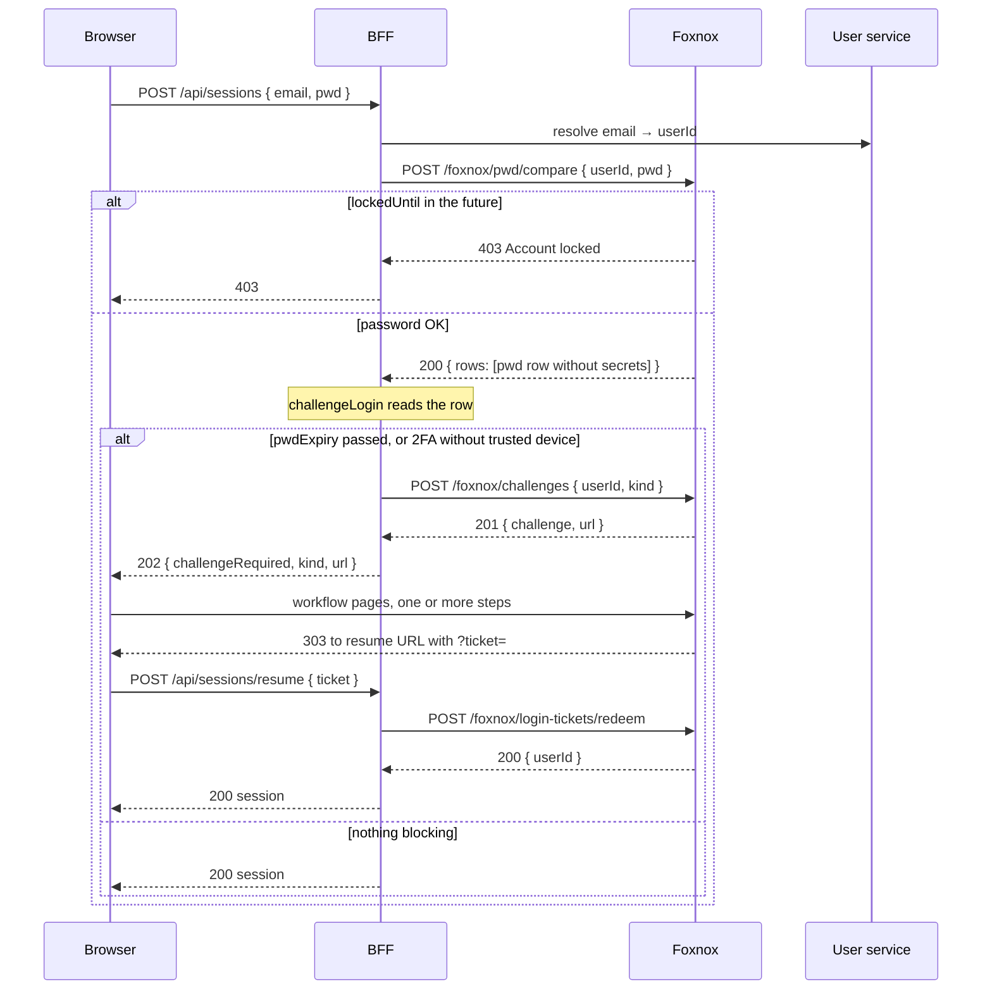
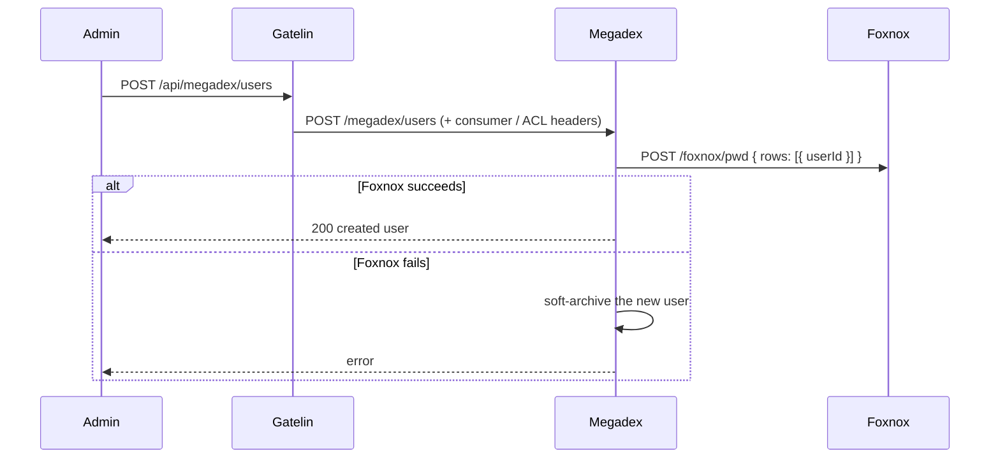
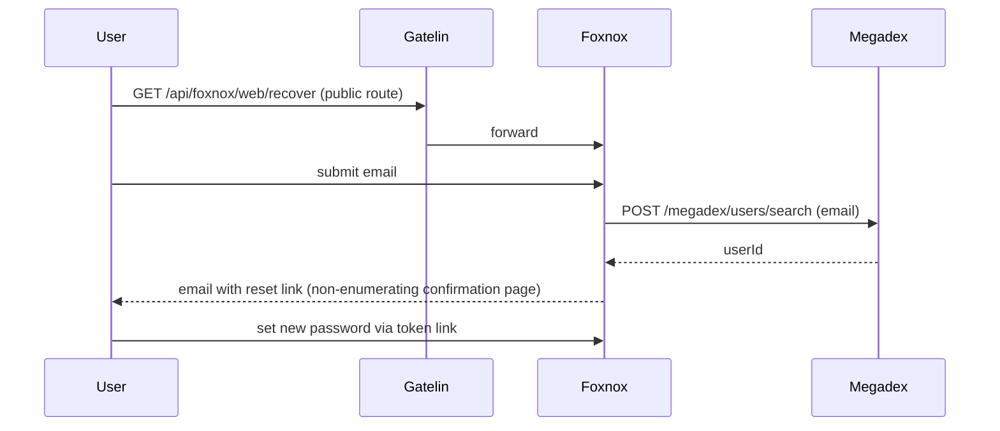

# Request Flow & Architecture

## Request Pipeline

```
Client Request
    ↓
[express.json] - JSON body parsing, 100kb limit
    ↓
[/foxnox/health] - Liveness + DB readiness (registered first, bypasses everything else)
    ↓
[startTimer] - Performance measurement
    ↓
[/foxnox/web/assets] - Static CSS/JS for the workflow pages
    ↓
[/foxnox/web] - Account workflow pages (Handlebars SSR)
    │     express.urlencoded → csrfProtection → page handler
    ↓
[JSON routers]
    ├── /foxnox/tokens            → token CRUD          → send(tEnt)
    ├── /foxnox/policies          → policy CRUD         → send(ppEnt)
    ├── /foxnox/devices/verify    → device check
    ├── /foxnox/devices           → device CRUD         → send(tdEnt)
    ├── /foxnox/challenges        → mint login challenge
    ├── /foxnox/login-tickets     → redeem resume ticket
    ├── /foxnox/pwd               → password CRUD + compare → sendPwd
    └── /foxnox/preferences       → admin table-view preferences → send(pEnt)
    ↓
[errorHandler]
```

One detail of this ordering is load-bearing.

**Health is registered before the timer and every router**, so a liveness probe never depends on anything else working. `/foxnox/health` is dependency-free; `/foxnox/health/ready` additionally runs `SELECT 1` against Postgres so an instance that lost its database leaves rotation instead of failing requests.


## Response Middlewares

Every JSON router ends in a terminal response middleware, and which one it uses is what keeps secrets out of responses:

| Middleware | Used by | Strips |
|---|---|---|
| `send(ppEnt)` | policies | nothing — no private fields |
| `send(tEnt)` | tokens | `hash` |
| `send(tdEnt)` | trusted devices | `deviceTokenHash` |
| `sendPwd` (`send(pEnt)`) | passwords | `pwdHash`, `twoFactorSecret` |

The entity definitions mark these fields `isPrivate`, which lets the service `SELECT` them for internal work — comparing a password, verifying a TOTP code, matching a device cookie — while the response layer removes them before serialization. Privacy is enforced once, at the boundary, rather than in each handler.

When the BFF forwards a permission with data restrictions, Foxnox enforces both headers around each JSON CRUD entity:

- `x-acl-fields` filters incoming write rows before entity validation and projects outgoing rows, schema descriptors, and history `record` snapshots. `id` is always retained. An omitted header is unrestricted; an empty header allows only `id`.
- `x-acl-conditions` is a JSON array of `{ field, op, value }`. Search predicates are forced into the query with `AND`. Inserts must satisfy the partition (an absent equality field is injected), and update/archive/history target IDs are checked before the operation. Updates cannot move a row outside its partition.
- `x-consumer-user-id` and `x-consumer-name` are mapped to `res.locals.consumer`, which lets `antity-pgsql` stamp creator/updater audit columns on inserts, updates, and archives.

Malformed ACL or consumer headers, unknown/non-filterable fields, and unsupported operators fail closed with **403**. Private entity properties are stripped before field projection and can never be re-enabled by an ACL header.

## Two Middleware Chains

The JSON and HTML surfaces are protected in completely different ways, because their clients are different.

**JSON routes** carry no session logic of their own. Authentication and route permission checks happen in the BFF. Foxnox then enforces the field and row restrictions the BFF resolved in `x-acl-fields` and `x-acl-conditions` at its own data boundary.

**Workflow pages** parse form bodies and enforce a signed double-submit CSRF
check on every non-`GET`: a `foxnox_csrf` cookie plus a matching hidden field,
both required, valid for an hour. Failures get **403** with no body. Every form
also carries a render timestamp; the three email-request forms add a honeypot
field. Handlers drop suspicious submissions with **204** and no explanation.
See [How Workflows Work](./workflows#form-protections).

## Where Foxnox Sits

```
┌─────────────────────────────────────────────────┐
│                  Reverse Proxy                   │
│                    (Traefik)                     │
│              http://your-domain.com              │
└────────────┬─────────────────────┬───────────────┘
             │                     │
   ┌─────────▼─────────┐  ┌────────▼──────────┐
   │   Admin Panel     │  │        BFF        │
   │   /foxnox/*       │  │   /api/*          │
   │   (Angular)       │  │   (Node.js)       │
   └───────────────────┘  └────────┬──────────┘
                                   │  internal network only
                          ┌────────▼──────────┐
                          │      Foxnox       │
                          │  /foxnox  /foxnox/web   │
                          │     (Node.js)     │
                          └────────┬──────────┘
                                   │
             ┌─────────────────────┼─────────────────┐
             │                     │                 │
   ┌─────────▼─────────┐  ┌────────▼───────┐  ┌──────▼──────┐
   │   PostgreSQL      │  │  User service  │  │    SMTP     │
   │   (foxnox DB)     │  │ USER_SEARCH_URL│  │             │
   └───────────────────┘  └────────────────┘  └─────────────┘
```

Foxnox has **no public API route**. Every request should reach it through a BFF,
which keeps `/foxnox/pwd/compare` off the open internet. Any BFF that authenticates callers,
issues sessions, and proxies `/foxnox` and `/foxnox/web` works. This
boundary depends on network trust: only the BFF and controlled operator
workloads should be able to connect to the Foxnox port, because Foxnox trusts
the BFF's authentication and ACL headers. Do not publish a Foxnox API router
or host port.

The user service is also a required production dependency, but remains a
separate system reached through `USER_SEARCH_URL`; Foxnox images do not bundle
user management. Because requests arrive through the BFF, Foxnox cannot infer
its public address, so the [public URL variables](./configuration#public-urls)
must be set explicitly for email links to work.

## Login, End to End

The interesting flow is a sign-in, because it involves both surfaces and three services. The sequence uses `POST /api/sessions` as the BFF login endpoint.



Note the division of labour. Foxnox answers questions about credentials and hosts the pages that fix problems; the BFF decides what those answers mean and issues the session. Foxnox never mints a JWT, which is why finishing a challenge produces a ticket rather than a login.

## Internal Integration Endpoints

Four endpoints are called by the BFF rather than by browsers, each configured on its own (BFF-side variable names, e.g. `PWD_CHECK_URL`, `PWD_CHALLENGES_URL`, `PWD_TRUSTED_DEVICES_URL`, and `PWD_LOGIN_TICKET_URL`):

| Endpoint | Called when |
|---|---|
| `POST /foxnox/pwd/compare` | Every login, to verify the password (also returns **403** when the account is locked) |
| `POST /foxnox/devices/verify` | Before minting a 2FA challenge, to check the device cookie |
| `POST /foxnox/challenges` | When a mid-login step is required (internal; after compare; `2fa` or `expired-password` only) |
| `POST /foxnox/login-tickets/redeem` | When the frontend resumes after a challenge |

See [Login Challenges](./api-challenges).

## Working Together: Gatelin, Foxnox and Megadex

Foxnox is one of three cooperating services: [Gatelin](https://gatelin.fr) is the BFF in front, [Megadex](https://megadex.fr) holds the users, and Foxnox holds their credentials.

```
┌─────────────────────────────────────────────────┐
│                  Reverse Proxy                   │
│                    (Traefik)                     │
│              http://your-domain.com              │
└────────────┬─────────────────────┬───────────────┘
             │                     │
   ┌─────────▼─────────┐  ┌────────▼──────────┐
   │   Admin Panels    │  │      Gatelin      │
   │     (Angular)     │  │   BFF  /api/*     │
   └───────────────────┘  └────────┬──────────┘
                                   │  internal network only
            ┌──────────────────────┼──────────────────────┐
            │                      │                      │
   ┌────────▼──────────┐           │             ┌────────▼──────────┐
   │      Megadex      │◄──────────┴─────────────┤      Foxnox       │
   │     /megadex      │     USER_SEARCH_URL     │  /foxnox  /web    │
   │     (Node.js)     ├────────────────────────►│     (Node.js)     │
   └────────┬──────────┘     PWD_CREATE_URL      └────────┬──────────┘
            │                                             │
   ┌────────▼──────────┐                         ┌────────▼──────────┐
   │    PostgreSQL     │                         │    PostgreSQL     │
   │   (megadex DB)    │                         │   (foxnox DB)     │
   └───────────────────┘                         └───────────────────┘
```

Each service owns its own database and knows the others only by HTTP contract.

| Service | Owns | Never does |
|---|---|---|
| **Gatelin** | Sessions, JWTs, routes, roles, permissions, CORS | Store password hashes or user profiles |
| **Megadex** | Users, roles assignment, social links, preferences, lookups | Store credentials or issue sessions |
| **Foxnox** | Password hashes, 2FA, tokens, trusted devices, workflow pages | Mint JWTs or store user profiles |

Users are identified by email at the edge and by numeric `userId` everywhere else. Megadex is the only place that translates one into the other.

### Sign-in

See [Login, End to End](#login-end-to-end); the user lookup in that sequence is answered by Megadex.

### Account creation



### Password recovery



### Who calls whom

| Caller | Callee | Variable | Purpose |
|---|---|---|---|
| Gatelin | Megadex | `USER_SEARCH_URL` | Resolve email to `userId` at login |
| Gatelin | Foxnox | `PWD_CHECK_URL` | Verify the password |
| Gatelin | Foxnox | `PWD_CHALLENGES_URL`, `PWD_TRUSTED_DEVICES_URL`, `PWD_LOGIN_TICKET_URL` | Mid-login 2FA / expired-password steps |
| Foxnox | Megadex | `USER_SEARCH_URL` | Resolve email in recovery, unlock, and 2FA recovery |
| Megadex | Foxnox | `PWD_CREATE_URL` | Create a password on user creation; archive it on user archival |
| Gatelin | Megadex, Foxnox | Route and permission seeds | Proxy admin and self-service traffic with consumer and ACL headers |

### Boundaries to keep in mind

- **Trust**: Megadex and Foxnox trust Gatelin's `x-consumer-*` and `x-acl-*` headers, so only Gatelin (and each other) may reach their ports. Neither should have a public router.
- **Sessions**: Gatelin owns session state. Role changes or archival in Megadex take effect only when the access token expires or refresh fails; nothing pushes a revocation.
- **Coupling**: Megadex creating a user fails (and rolls back by archiving) if Foxnox is down. Gatelin login fails if Megadex or Foxnox is unreachable.
- **Optional**: Each service works with other implementations of the same HTTP contract. A custom BFF, user service, or credential store can replace any one of the three.

### Reference values

The other pages use generic placeholders. For the three services shipped together, the concrete values are:

| Placeholder | Concrete value |
|---|---|
| `<bff-image>` / `<bff-migration-image>` | `ghcr.io/alten-group/gatelin` / `ghcr.io/alten-group/gatelin-migration` |
| `<bff-seed-folder>` | `gatelin-data` (`db/liquibase/gatelin-data/` in the Foxnox and Megadex checkouts) |
| `/api/<bff>/roles/search` (`ADMIN_ROLES_SEARCH_URL`) | `/api/gatelin/roles/search` |
| Password service URLs (`/pwd`, `/pwd/compare`, `/challenges`, `/devices/verify`, `/login-tickets/redeem`) | the same paths under `/foxnox`, on `ghcr.io/alten-group/foxnox` |
| `ADMIN_PASSWORD_RECOVERY_URL` example (`/api/password-service/web/recover`) | `/api/foxnox/web/recover` |
| User service URL (`/users/search`) | `/megadex/users/search`, on `ghcr.io/alten-group/megadex` |

## Background Jobs

Started with the process, before the HTTP listener:

- **Delete archived entities** — daily 02:00 UTC; removes passwords, tokens, policies, and trusted devices archived for more than 2 months
- **Delete old history** — daily 03:00 UTC; removes `log.history` rows older than 6 months

Neither job is responsible for expiry. Expired tokens and lapsed device trust stop working because every lookup filters on `expiresAt`, not because something deleted them — which is why security does not depend on a cron job having run.

## Technology

| Layer | Choice |
|---|---|
| Runtime | Node.js 24, ES modules |
| HTTP | Express 5 |
| Templates | express-handlebars |
| Database | PostgreSQL 16, via `@dwtechs/antity-pgsql` |
| Migrations | Liquibase 4.28 |
| Hashing | `@dwtechs/hashitaka` (salted PBKDF2 for passwords and security answers; HMAC for tokens and device cookies), `@dwtechs/passken` (generation and compare) |
| TOTP | `otpauth` |
| Mail | Nodemailer |
| Admin UI | Angular 22 with OpenNG Optimus UI |
