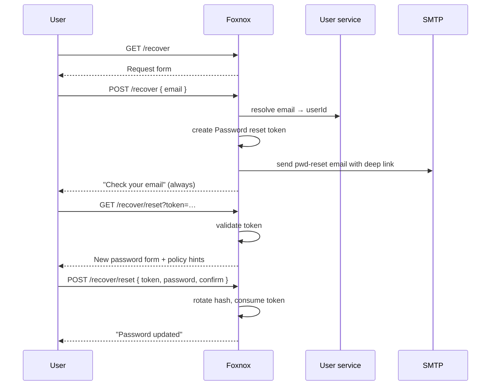

# Password Recovery

The "I forgot my password" flow. A user who cannot sign in asks for a reset link by email, then chooses a new password.

Driven by the **Password reset** token type: 30 minute lifetime, 3 attempts.

## Pages

| Page | Path | Purpose |
|---|---|---|
| Request | `GET/POST /recover` | Enter the account email address |
| Sent | after `POST` | Always shown after submit, to avoid revealing whether the account exists |
| Reset | `GET/POST /recover/reset?token=…` | Choose a new password |
| Done | after `POST` | Password changed |
| Invalid | on bad token | Link missing, expired, or already used |

## Flow



## Requesting a Link

The request form takes an email address and nothing else. What happens next depends on whether that address resolves to a user, but **the page you see does not** — the confirmation is identical either way.

If the address is malformed, the form comes back with `Enter a valid email address.` and a **400**. If the submission looks automated, it is dropped with **204** and no explanation.

## Choosing a New Password

Opening the link validates the token before rendering anything. A missing, expired, consumed, or over-attempted token gets the invalid page with a link to request a fresh one — the form is never shown for a token that could not be used.

The reset form itself asks for the password twice and displays the requirements from the in-force [password policy](./api-policies), so the rules the user sees are the rules that will actually be applied.

Three things can send the form back:

| Error | Cause |
|---|---|
| `Passwords do not match.` | The two fields differ |
| `Password does not meet the security policy.` | Too short, or missing a required character class |
| `This reset link is invalid or has expired.` | Token failed revalidation between rendering and submitting |

The token is checked again on submit, not just on render. A form left open past the 30 minute window fails at that point rather than rotating the password.

## What Changes

On success, the `pwd` row's hash is rotated (with `pwdUpdatedAt` and a fresh
`pwdExpiry` derived from the policy), lockout counters are cleared, and the token
is consumed so the link cannot be reused. The account must still be active and
not archived when the reset is submitted. An unavailable user service blocks the
reset rather than trusting an earlier lookup.

2FA is untouched, so the next sign-in still asks for a code when enrolled.

## Restored Users

Restoring a profile in the user service does not restore its previous password
or sessions and does not send an email automatically. The user selects
**Forgot password** from the login page and follows this same recovery flow.

If no active password exists, recovery selects the newest archived password row
(highest id), replaces its hash with the newly chosen password, and unarchives
that row in the same SQL update. Its 2FA enrollment is preserved, older password
rows stay archived, and the old password is never reactivated. If an active
password already exists, normal rotation applies without restoring older rows.

A still-archived or inactive profile cannot complete recovery, even with an
otherwise valid reset link. If all password rows have been permanently purged,
recovery fails rather than silently creating a credential without its original
2FA state; an administrator must provision the account separately.

No session is created or restored by password recovery. The user must sign in
again with the new password and complete any required 2FA.

## Linking to It

Add this to your login page:

```
/api/foxnox/web/recover
```

For the admin UI shipped with the BFF, set `ADMIN_PASSWORD_RECOVERY_URL=/api/foxnox/web/recover` and the "Forgotten password?" link appears on the login form automatically.
